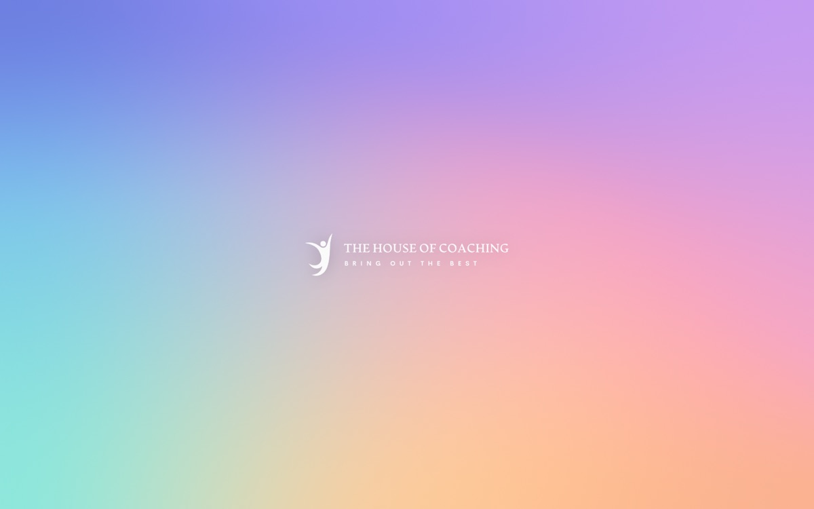
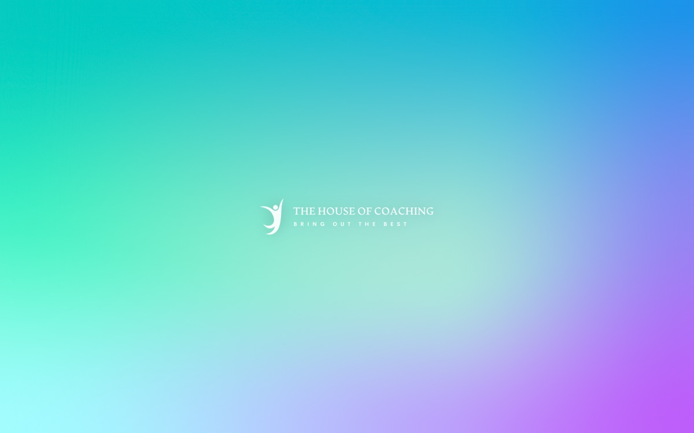
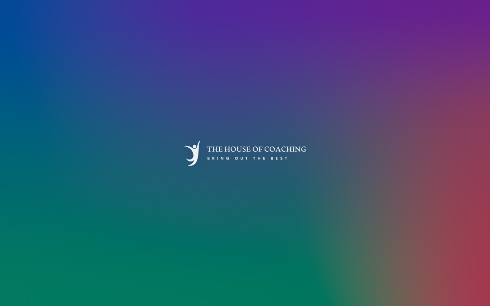
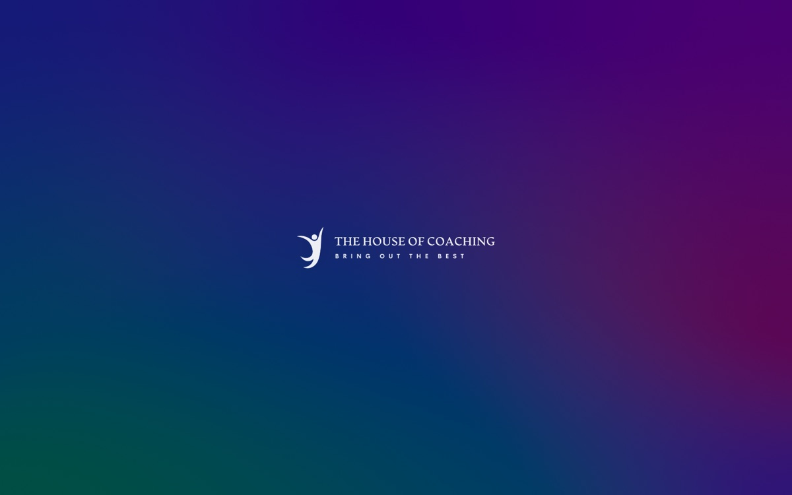

# Dayshade

Dayshade (formerly THOC Wall) is a living desktop wallpaper for macOS. Soft mesh gradients drift slowly behind your desktop icons, their colours follow the sun where you are, and they deepen when your Mac switches to dark mode.

| Dawn, light mode | Midday, light mode |
|---|---|
|  |  |
| **Dusk, dark mode** | **Night, dark mode** |
|  |  |

## What it does

- **Follows the day.** The colours move through seven schemes with the real position of the sun: night, dawn, morning, midday, afternoon, golden hour and dusk. A winter day in Belgium looks softer than a summer one, because the sun stays lower.
- **Follows light and dark mode.** Dark mode uses deep, jewel-toned versions of every scheme and crossfades when macOS switches.
- **Your colour schemes.** Edit the built-in schemes, add as many of your own as you like, and share them as small JSON files.
- **Logos.** The CoachSteff logo is in by default, and The House of Coaching logo is one click away. Add your own marks (SVG, PDF or PNG) and place each one on a grid.
- **Bars and shelves.** Glassy panels on the wallpaper: a strip under the menu bar, a shelf behind the Dock, or zones for files on your desktop.
- **Light on your Mac.** It draws nothing while the screen sleeps or a full-screen app covers it, and slows down in Low Power Mode. Typical use is around 5 to 8% of one CPU core.

It runs as a small menu bar app. It sits at desktop level, so your desktop icons, Finder and every window stay on top, and clicks go straight through to the desktop.

## Requirements

- macOS 15 Sequoia or later, on Apple silicon
- Xcode command line tools to build it (`xcode-select --install`)

## Install

```bash
git clone https://github.com/CoachSteff/dayshade.git
```

```bash
cd dayshade && ./build.sh install
```

`build.sh` compiles the app into `build/Dayshade.app`. With `install` it also copies it to `~/Applications` and starts it. There are no dependencies to download.

To start it with your Mac, open Settings › General and turn on **Open at login**. macOS may ask you to confirm in System Settings › General › Login Items.

## Using it

Click the sun-on-the-horizon icon in the menu bar for:

- **About Dayshade**: version, author and licence
- today's sunrise and sunset, and where the sun is now
- **Colour Scheme**: switch schemes without opening Settings
- **Pause Animation**, **Show Logos and Bars**
- **Preview a Whole Day**: 24 hours of colour in one minute
- **Settings…** (⌘,)

If you hide the menu bar icon, open Dayshade again from Applications to get back to Settings.

### Settings

The live preview at the top shows every change as you make it.

**Colours**
- *Appearance*: Auto follows macOS. Light or Dark pins one.
- *Colour schemes*: Day cycle, or any single scheme kept all day. Select a scheme to edit its name and its nine colours. The built-in schemes can be reset to their originals; your own can be duplicated, exported and deleted. Changing a built-in scheme also changes that part of the day cycle.
- *Feel*: motion, vibrance, dark mode depth and a paper-like grain.
- *Time of day*: use your location (approximate, city level, refreshed when your Mac wakes) or search for any place. *Try a time* scrubs through the day; *Play a day* runs through it in a minute.

**Logos** and **Bars**
Every item is a zone on a 24 × 16 grid that stands for your main screen. Violet is the selected item, grey your other items, and a tint marks items from the other pane (teal for bars, blue for logos), so you can line them up.

- Drag a zone to move it.
- Drag its bottom-right corner to resize it.
- Drag across empty cells to redraw the selected zone.
- The pointer shows which of these a drag will do.

Menu bar strips and Dock shelves follow the real menu bar and Dock, so they can be selected but not moved. A Dock shelf hides while the Dock hides itself.

**General**
Open at login, menu bar icon, pause, frame rate, an *Export Current Frame* button, and *Keep the system wallpaper in step*. That last option saves a still every ten minutes and sets it as your macOS wallpaper, so the lock screen and Mission Control match. It replaces your current wallpaper, so it is off by default. Logos and bars are left off that still unless you turn on *Show logos on the login screen* or *Show bars on the login screen*, so the login and lock screen stay a clean gradient.

### Colour scheme files

Export and Import use plain JSON. One scheme:

```json
{
  "name": "Sea",
  "colors": ["00CABF", "0EB6D6", "1894E9",
             "49F2C7", "AAE6DA", "8F88F1",
             "A1FCFE", "BBA0FB", "BD5EFA"]
}
```

or a list of them, as written by *Export All*. The nine colours are a 3 × 3 grid read row by row from the top left: the top row is the top edge of the screen, the middle colour sits behind the logo. A leading `#` is fine. Imported schemes are always added as new ones and never overwrite yours.

## Command line

The app binary doubles as a renderer, handy for previews or a matching lock-screen picture:

```bash
"build/Dayshade.app/Contents/MacOS/Dayshade" --render out.png --hour 7.5 --size 3024x1964
```

Add `--dark` for dark mode. It uses your saved settings. Two more options help when testing:

| Option | Effect |
|---|---|
| `-simulatedHour 19.5` | Pins the clock to that hour |
| `-forceAppearance dark` | Ignores the system appearance |
| `-snapshotSettings out.png -settingsPane logos` | Saves a picture of a Settings pane and quits |

## Building and changing it

The code is plain Swift and SwiftUI with no packages, built by `swiftc` from `build.sh`. The version number lives in `build.sh`. See [docs/ARCHITECTURE.md](docs/ARCHITECTURE.md) for how the pieces fit together, and [CHANGELOG.md](CHANGELOG.md) for what changed.

Settings are stored in the user defaults domain `io.github.coachsteff.dayshade`. Logos you add are copied to `~/Library/Application Support/Dayshade/Logos`.

## Licence

Dayshade is copyleft free software, released under the **GNU General Public License, version 3 or later**. You may use, study, share and change it, as long as anything you distribute stays under the same licence and keeps its source open. See [LICENSE](LICENSE).

**The built-in logos are not covered by the GPL.** The CoachSteff logo in `Resources/coachsteff.svg` belongs to Steff Vanhaverbeke, The House of Coaching logo in `Resources/thoc.svg` to The House of Coaching. If you build your own version, replace them with your own.

## Author

Made by Steff Vanhaverbeke. The original gradients were sampled from The House of Coaching's wallpaper set.
